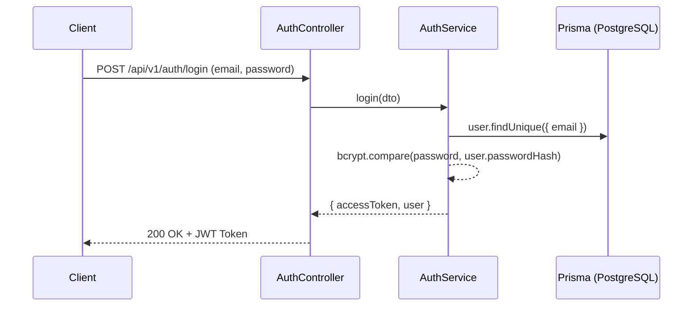

# 🔐 Module: Authentication & Users Management

## Mục đích
Quản lý xác thực người dùng bằng JWT, đăng ký tài khoản mới, phân quyền và quản lý thông tin tài khoản (profile, đổi mật khẩu).

---

## Các thành phần chính

- `AuthController` (`src/modules/auth/auth/auth.controller.ts`):
  - `POST /api/v1/auth/register`: Đăng ký tài khoản người dùng mới
  - `POST /api/v1/auth/login`: Xác thực credentials và phát hành JWT access token
  - `GET /api/v1/auth/profile`: Lấy thông tin tài khoản hiện tại từ token (yêu cầu auth)
- `AuthService` (`src/modules/auth/auth/auth.service.ts`):
  - `register(dto: RegisterDto)`: Hash mật khẩu bằng `bcryptjs`, kiểm tra trùng lặp email và tạo bản ghi User
  - `login(dto: LoginDto)`: So khớp password hash, tạo JWT payload và ký token
- `UsersController` (`src/modules/auth/users/users.controller.ts`):
  - `GET /api/v1/users`: Danh sách người dùng (quản trị)
  - `POST /api/v1/users/change-password`: Cập nhật mật khẩu người dùng
- `UsersService` (`src/modules/auth/users/users.service.ts`):
  - CRUD thao tác bảng `User` qua `PrismaService`
- `JwtAuthGuard` (`src/common/guards/jwt-auth.guard.ts`):
  - Guard bảo vệ các route yêu cầu Bearer JWT token
- `CurrentUser` (`src/common/decorators/current-user.decorator.ts`):
  - Custom param decorator trích xuất payload user đã được giải mã từ request

---

## Luồng dữ liệu

---

## Dependencies

- **Phụ thuộc vào**:
  - `PrismaService` (`src/database/prisma.service.ts`)
  - `ConfigService` (`auth.jwtSecret`, `auth.jwtExpiresIn`)
  - `@nestjs/jwt`, `bcryptjs`
- **Được sử dụng bởi**:
  - Tất cả các endpoint được bảo vệ qua `@UseGuards(JwtAuthGuard)`

---

## Edge cases & Lưu ý

- Mật khẩu phải được hash trước khi lưu vào DB, không bao giờ log plaintext password.
- Token hết hạn hoặc sai secret sẽ trả về lỗi `401 Unauthorized` đồng bộ qua `AllExceptionsFilter`.
- Đảm bảo kiểm tra `isEmailUnique` trước khi insert để tránh race conditions gây 500.

---

## Cập nhật lần cuối
2026-10-19 — Khởi tạo tài liệu module theo chuẩn `rules/rule-docs.md`.
