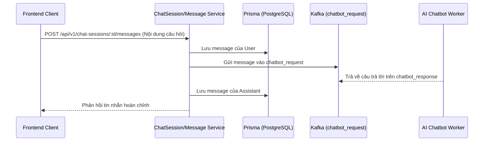

# 💬 Module: Chatbot & AI Assistant

## Mục đích
Quản lý các phiên hội thoại (chat sessions) và tin nhắn (chat messages) với AI hỗ trợ nghiên cứu khoa học. Hỗ trợ 3 phân loại bot:
1. `outer_chatbot`: Chatbot học thuật tổng quát, tra cứu khái niệm bên ngoài.
2. `inner_chatbot`: Chatbot RAG ngữ cảnh bài viết dựa trên tài liệu người dùng và trích dẫn.
3. `writer_chatbot`: Agent tư vấn phương pháp, xây dựng luận điểm và viết tự động.

---

## Các thành phần chính

- `ChatSessionController` & `ChatSessionService` (`src/modules/chatbot/chat-session/`):
  - Khởi tạo phiên trò chuyện mới theo loại bot (`outer_chatbot`, `inner_chatbot`, `writer_chatbot`)
  - Gắn phiên chat với một `documentId` cụ thể khi dùng `inner_chatbot`
  - Đổi tên tiêu đề phiên, tra cứu lịch sử và xóa phiên chat
- `ChatMessageController` & `ChatMessageService` (`src/modules/chatbot/chat-message/`):
  - Lưu trữ tin nhắn gửi từ người dùng (`user`) và phản hồi từ AI (`assistant`)
  - Hỗ trợ lưu trữ tin nhắn phân cấp / luồng phụ nếu có (`create-nested-chat-message.dto.ts`)
- `ChatbotModule` (`src/modules/chatbot/chatbot.module.ts`):
  - Gom cụm `ChatSessionModule` và `ChatMessageModule` thành một domain thống nhất

---

## Luồng dữ liệu

---

## Dependencies

- **Phụ thuộc vào**:
  - `PrismaService`: Lưu trữ các bảng `ChatSession` và `ChatMessage`
  - `MessagingModule`: Kafka client kết nối tới AI Chatbot Worker
  - `DocumentSetupModule`: Cung cấp ID tài liệu khi mở phiên chat nội bộ (`inner_chatbot`)
- **Được sử dụng bởi**:
  - Frontend chat sidebar và floating widget trong giao diện soạn thảo

---

## Edge cases & Lưu ý

- Khi phiên chat là `inner_chatbot`, bắt buộc phải truyền `documentId` hợp lệ để worker có thể kích hoạt RAG trên vector DB.
- Khi tải lại lịch sử tin nhắn, phân trang (pagination) theo thời gian `createdAt` để tránh làm chậm hệ thống khi phiên chat có hàng trăm tin nhắn.

---

## Cập nhật lần cuối
2026-10-19 — Khởi tạo tài liệu module theo chuẩn `rules/rule-docs.md`.
