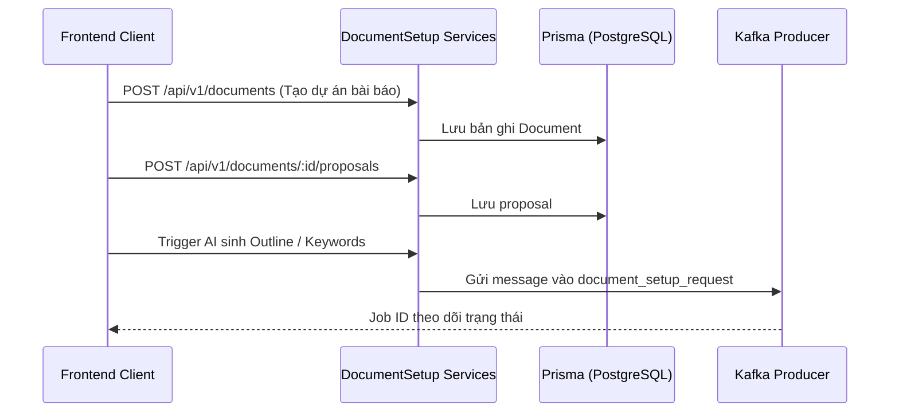

# 📄 Module: Document Setup

## Mục đích
Quản lý giai đoạn thiết lập tài liệu nghiên cứu: thông tin tổng quan bài viết (document), đề cương (outline), đề xuất nghiên cứu (proposal), từ khóa (keywords), tài liệu trích dẫn tham khảo (references), và tài liệu PDF người dùng tải lên (user uploaded documents).

---

## Các thành phần chính

- `DocumentController` & `DocumentService` (`src/modules/document-setup/document/`):
  - CRUD thông tin tài liệu nghiên cứu của user
  - Gán và liên kết tài liệu tham khảo với bài viết (`attach-reference.dto.ts`)
- `ProposalController` & `ProposalService` (`src/modules/document-setup/proposal/`):
  - Quản lý tiêu đề nghiên cứu đề xuất, câu hỏi nghiên cứu, giả thuyết và mô hình
- `OutlineController` & `OutlineService` (`src/modules/document-setup/outline/`):
  - Quản lý mục lục và cấu trúc phân cấp các chương/tiểu mục (sections/subsections)
- `ReferenceController` & `ReferenceService` (`src/modules/document-setup/reference/`):
  - Lưu trữ metadata trích dẫn khoa học (tác giả, năm, doi, abstract, journal)
- `DocumentKeywordController` & `DocumentKeywordService` (`src/modules/document-setup/document-keyword/`):
  - Quản lý tập từ khóa chuyên ngành gắn với tài liệu
- `UserUploadedDocumentController` & `UserUploadedDocumentService` (`src/modules/document-setup/user-uploaded-document/`):
  - Quản lý file PDF/tài liệu người dùng tải lên để AI bóc tách nội dung và trích xuất

---

## Luồng dữ liệu

---

## Dependencies

- **Phụ thuộc vào**:
  - `PrismaService`: Thao tác dữ liệu bảng `Document`, `Proposal`, `Outline`, `Reference`
  - `MessagingModule`: Gửi request sang AI Document Setup worker qua Kafka
  - `JobsModule`: Khởi tạo và cập nhật trạng thái async jobs
- **Được sử dụng bởi**:
  - `WriteReportModule`: Lấy cấu trúc đề cương và tài liệu tham khảo để viết nội dung
  - `ChatbotModule`: Truy vấn ngữ cảnh bài viết cho Inner Chatbot

---

## Edge cases & Lưu ý

- Khi xóa Document, cần xử lý quan hệ ràng buộc (cascade delete hoặc kiểm tra dữ liệu phụ thuộc như outline, proposal).
- Metadata trích dẫn (references) từ OpenAlex/PDF upload cần validate schema trước khi lưu.
- Cấu trúc outline phân cấp (cha/con) cần đảm bảo không bị vòng lặp vô tận (cyclic hierarchy).

---

## Cập nhật lần cuối
2026-10-19 — Khởi tạo tài liệu module theo chuẩn `rules/rule-docs.md`.
