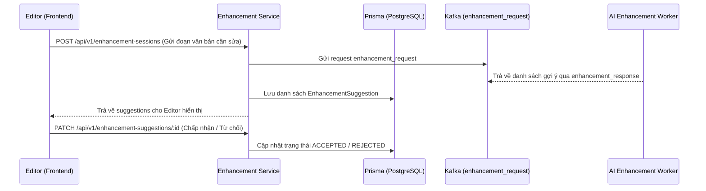

# ✨ Module: Enhancement (In-Doc AI Suggestions)

## Mục đích
Hỗ trợ tối ưu hóa văn phong khoa học trực tiếp trong trình soạn thảo: đề xuất sửa ngữ pháp, viết lại nâng cao tính học thuật (academic tone), tóm tắt, mở rộng ý và áp dụng các chỉnh sửa trực tiếp vào tài liệu nghiên cứu.

---

## Các thành phần chính

- `EnhancementAiController` & `EnhancementAiService` (`src/modules/enhancement/`):
  - Điều phối Kafka request cho 4 AI events: `ai_in_doc`, `get_suggestions`, `enhance`, `enhance_all`
  - Đồng bộ kết quả gợi ý và trạng thái vào PostgreSQL (`enhancement_sessions`, `enhancement_suggestions`, `jobs`)
- `EnhancementSessionController` & `EnhancementSessionService` (`src/modules/enhancement/enhancement-session/`):
  - Quản lý phiên gợi ý trau chuốt theo từng văn bản / tài liệu cụ thể
  - Hỗ trợ endpoint gắn theo tài liệu (`document-enhancement-session.controller.ts`)
- `EnhancementSuggestionController` & `EnhancementSuggestionService` (`src/modules/enhancement/enhancement-suggestion/`):
  - Lưu trữ chi tiết các gợi ý thay đổi (vị trí đoạn văn, nội dung gốc, nội dung đề xuất, lý do chỉnh sửa)
  - Quản lý trạng thái gợi ý: `PENDING`, `ACCEPTED`, `REJECTED`
  - Hỗ trợ tạo gợi ý lồng nhau nếu có (`create-nested-enhancement-suggestion.dto.ts`)
- `EnhancementModule` (`src/modules/enhancement/enhancement.module.ts`):
  - Kết nối `EnhancementAiController`, `EnhancementAiService`, `EnhancementSessionModule` và `EnhancementSuggestionModule`

---

## Luồng dữ liệu

---

## Dependencies

- **Phụ thuộc vào**:
  - `PrismaService`: Quản lý bảng `EnhancementSession` và `EnhancementSuggestion`
  - `MessagingModule`: Gửi yêu cầu qua Kafka topic `enhancement_request`
  - `DocumentSetupModule` / `WriteReportModule`: Cung cấp ID tài liệu ngữ cảnh
- **Được sử dụng bởi**:
  - Trình soạn thảo văn bản học thuật (Rich Text / Markdown Editor)

---

## Edge cases & Lưu ý

- Trạng thái `ACCEPTED` cần được đồng bộ ngược lại với nội dung của Section/Report trong `WriteReportModule`.
- Người dùng có thể chỉnh sửa thủ công tài liệu khiến vị trí offset của gợi ý bị lệch, cần xử lý logic fallback khi áp dụng thay đổi.

---

## Cập nhật lần cuối
- 2026-10-19 — Khởi tạo tài liệu module theo chuẩn `rules/rule-docs.md`.
- 2026-10-20 — Bổ sung `EnhancementAiService` và `EnhancementAiController` tích hợp Kafka cho 4 AI events (`ai_in_doc`, `get_suggestions`, `enhance`, `enhance_all`).
