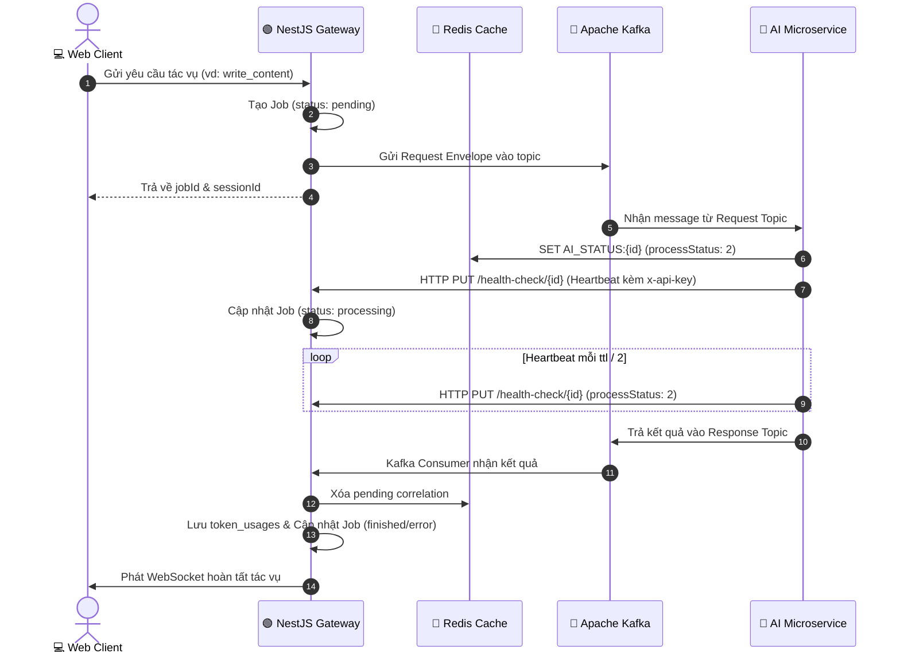

# 🔌 ĐẶC TẢ TÍNH NĂNG: HẠ TẦNG KẾT NỐI, HEALTH-CHECK WEBHOOK & REDIS STATE

> Thuộc phân hệ: **Core Platform & Messaging Foundation**  
> Tham chiếu: [KAFKA_FULL_SCHEMA_AND_WORKFLOW.md (Mục 3, 4, 5)](file:///home/hiubao/Projects/03_Work/Company/auto-research-be/KAFKA_FULL_SCHEMA_AND_WORKFLOW.md)

---

## 1. Mô tả chức năng
Cung cấp hạ tầng giao tiếp hai chiều bất đồng bộ giữa Core Backend và 4 AI Microservices. Bao gồm:
1. **Webhook Health-Check HTTP `PUT /health-check/:id`**: Nhận tín hiệu heartbeat định kỳ (`ttl / 2`) và cập nhật trạng thái tiến trình `processStatus` (PENDING, PROCESSING, FINISHED, ERROR, SUSPENDED).
2. **Quản trị State trên Redis**: Cập nhật khóa `AI_STATUS:{id}` và lưu trữ API keys của LLM (`AI_KEY:{model_id}`), Qdrant (`AI_KEY:db_key`), Search Web (`AI_KEY:search_web_key`).
3. **Message Envelope & Request Correlation**: Tự động ghép nối Kafka Response với Client request và ghi nhận `TokenUsage`.

---

## 2. Đặc tả Input (Yêu cầu đầu vào)

### 2.1. Webhook HTTP `PUT /health-check/:id`
- **URL**: `http://{BACKEND_HOST}:4002/health-check/{id}` (với `{id}` là `document_id` hoặc `conv_id`).
- **Headers**:
  - `Content-Type: application/json`
  - `x-api-key`: Khóa bí mật đồng bộ định nghĩa trong `API_KEY_ID`.
- **Payload Schema**:
  ```json
  {
    "eventType": "write_content",
    "processStatus": 2,
    "aiError": {
      "errorCode": null,
      "error": null
    }
  }
  ```
- **Kiểu dữ liệu**:
  - `eventType` (`string`, bắt buộc): Tên event AI đang chạy.
  - `processStatus` (`number`, bắt buộc): `1` (PENDING), `2` (PROCESSING), `3` (FINISHED), `4` (ERROR), `5` (SUSPENDED).
  - `aiError` (`object`): `{ errorCode: number | null, error: string | null }`.

### 2.2. Request Envelope gửi vào Kafka (Tất cả Request Topics)
```json
{
  "event_type": "string",
  "model_id": "string (mặc định 'localhost')",
  "user_id": "string (UUID)",
  "document_id": "string (hoặc conv_id)",
  "session_id": "string",
  "language": "string (mặc định 'Vietnamese')",
  "job_id": "string (UUID)"
}
```

---

## 3. Đặc tả Output (Kết quả đầu ra)

### 3.1. Phản hồi Webhook HTTP
- **Thành công**: `HTTP 200 OK`
  ```json
  { "success": true, "message": "Heartbeat updated successfully" }
  ```
- **Lỗi xác thực**: `HTTP 401 Unauthorized` (`Invalid or missing x-api-key`).

### 3.2. Cập nhật State trên Redis (`AI_STATUS:{id}`)
```json
{
  "eventType": "write_content",
  "processStatus": 2,
  "aiError": { "errorCode": null, "error": null },
  "updatedAt": 1729342200000
}
```

### 3.3. Tự động ghi nhận `TokenUsage` trong Database
Mỗi khi nhận Kafka Response có trường token, tự động lưu vào bảng `token_usages`:
`{ userId, documentId, convId, eventType, modelId, inputTokens, outputTokens, embedTokens, embedModel, webSearchCall }`.

---

## 4. Luồng hoạt động (Workflow Sequence)


