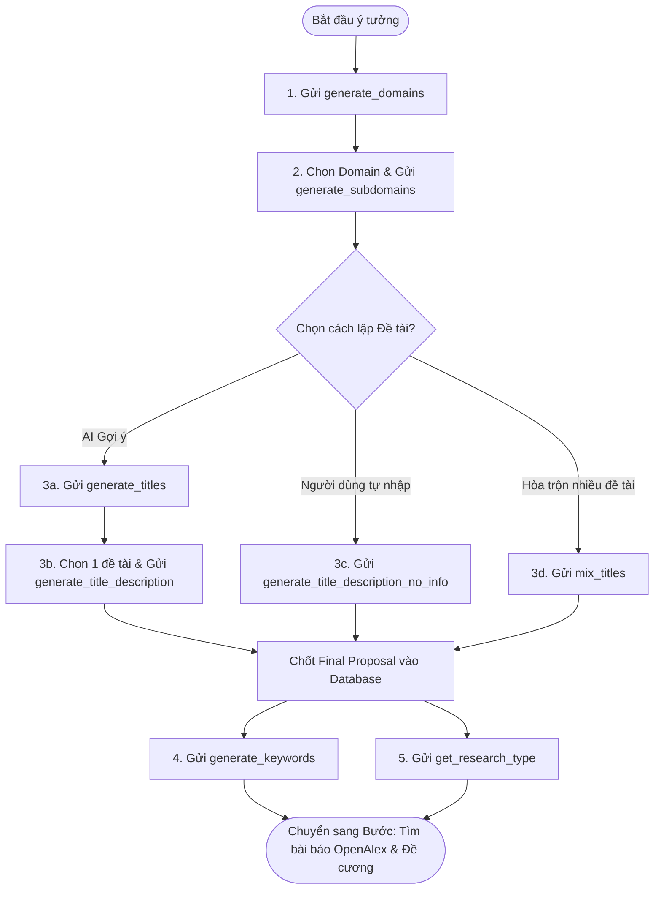

# 💡 ĐẶC TẢ TÍNH NĂNG: KHỞI TẠO Ý TƯỞNG & ĐỀ XUẤT NGHIÊN CỨU (DOC SETUP)

> Thuộc phân hệ: **Document Setup Service (Service 1 - Nhóm Ideation & Proposals)**  
> Tham chiếu: [KAFKA_FULL_SCHEMA_AND_WORKFLOW.md (Mục 6.3 - 6.10)](file:///home/hiubao/Projects/03_Work/Company/auto-research-be/KAFKA_FULL_SCHEMA_AND_WORKFLOW.md)  
> Kafka Topics: `document_setup_request` ➡️ `document_setup_response` *(hoặc `_local`)*

---

## 1. Mô tả chức năng
Cung cấp bộ công cụ AI hỗ trợ nhà nghiên cứu định hình đề tài nghiên cứu từ giai đoạn ý tưởng sơ khởi:
- Tự động gợi ý danh sách ngành (`generate_domains`) và hướng nghiên cứu chuyên sâu (`generate_subdomains`).
- Sinh từ khóa tìm kiếm tài liệu chính và phụ (`generate_keywords`).
- Đề xuất danh sách tên đề tài kèm tính cấp thiết và khoảng trống nghiên cứu (`generate_titles`).
- Chi tiết hóa đề tài từ Knowledge Base (`generate_title_description`) hoặc từ tên tự nhập (`generate_title_description_no_info`).
- Phối trộn các đề tài tiềm năng thành một đề tài độc đáo mới (`mix_titles`).
- Phân tích và tư vấn phương pháp luận nghiên cứu định tính, định lượng hoặc hỗn hợp (`get_research_type`).

---

## 2. Đặc tả Input (100% Request Fields)

| Event Type | Trường bắt buộc | Trường tùy chọn | Mô tả dữ liệu gửi vào Kafka |
|---|---|---|---|
| `generate_domains` | `field` (str), `domains_num` (int) | `is_tool` (bool, default: false) | Lĩnh vực lớn (vd: "Công nghệ thông tin"), số lượng ngành cần sinh. |
| `generate_subdomains` | `field` (str), `domain` (str), `subdomains_num` (int) | `is_tool` (bool, default: false) | Lĩnh vực và ngành đã chọn, số lượng hướng chuyên sâu. |
| `generate_keywords` | `proposal` (dict) | - | `proposal` chứa: `title`, `problem_statement`, `motivation`, `research_gap`. |
| `generate_titles` | `field` (str), `domain` (str), `subdomains` (list[str]), `level` (str: bachelor/master/phd) | `use_web_search` (bool, default: false) | Sinh 3-5 đề xuất đề tài mới từ chuyên ngành và trình độ học thuật. |
| `generate_title_description` | `field`, `domain`, `title`, `level`, `knowledge_base` (list[dict]) | - | Tri thức nền tảng trích xuất từ bước `generate_titles`. |
| `generate_title_description_no_info` | `title` (str), `level` (str) | `use_web_search` (bool, default: false) | Người dùng tự nhập tên đề tài, AI tự phân loại lĩnh vực & ngành. |
| `mix_titles` | `field`, `domain`, `level`, `proposals` (list[dict]) | - | Danh sách ≥ 2 proposals cần hòa trộn. |
| `get_research_type` | `field`, `domain`, `proposal` (dict) | - | Bản đề tài đã chốt để phân tích phương pháp phù hợp. |

*Lưu ý: Mọi request đều kèm khung định danh chung: `event_type`, `model_id`, `user_id`, `document_id`, `session_id`, `language`.*

---

## 3. Đặc tả Output (100% Response Fields & Database Sync)

```json
// generate_titles response
{
  "event_type": "generate_titles",
  "document_id": "doc-uuid",
  "proposals": [
    {
      "title": "Ứng dụng AI trong Chẩn đoán Y tế",
      "problem_statement": "Thiếu hụt bác sĩ chuyên khoa tại tuyến huyện...",
      "motivation": "Nâng cao độ chính xác sàng lọc sớm...",
      "research_gap": "Chưa có mô hình tối ưu cho ảnh X-quang độ phân giải thấp"
    }
  ],
  "knowledge_base": [{ "source": "...", "content": "..." }],
  "input_tokens": 850,
  "output_tokens": 1200
}
```

```json
// get_research_type response
{
  "event_type": "get_research_type",
  "document_id": "doc-uuid",
  "research_type": {
    "type": 1, // 0 = Định tính, 1 = Định lượng, 2 = Hỗn hợp
    "reason": "Đề tài cần kiểm định mô hình hồi quy với mẫu khảo sát n >= 300..."
  }
}
```

**Đồng bộ cơ sở dữ liệu:**
- `domains`, `subdomains`, `researchType`: Lưu vào bảng `documents`.
- `proposals`: Lưu danh sách vào bảng `proposals` (gán `isSelected = false`, khi user chọn chốt 1 đề tài thì bật `isSelected = true`).
- `keywords`: Lưu `keywordsMain` và `keywordsSub` vào bảng `document_keywords`.

---

## 4. Luồng hoạt động (Workflow Flowchart)


