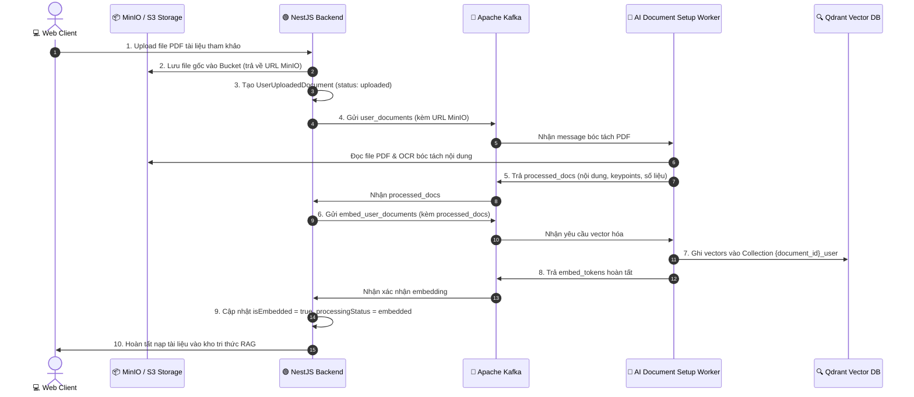

# 📚 ĐẶC TẢ TÍNH NĂNG: KHAI THÁC BÀI BÁO, PDF MINIO & VECTOR QDRANT

> Thuộc phân hệ: **Document Setup Service (Service 1 - Nhóm Papers & Vector Storage)**  
> Tham chiếu: [KAFKA_FULL_SCHEMA_AND_WORKFLOW.md (Mục 6.1, 6.2, 6.15 - 6.20)](file:///home/hiubao/Projects/03_Work/Company/auto-research-be/KAFKA_FULL_SCHEMA_AND_WORKFLOW.md)  
> Kafka Topics: `document_setup_request` ➡️ `document_setup_response` *(hoặc `_local`)*

---

## 1. Mô tả chức năng
Cung cấp giải pháp toàn diện về dữ liệu nghiên cứu và tri thức RAG:
- Tìm kiếm tự động bài báo khoa học chất lượng cao từ OpenAlex và Scimago (`search_papers`).
- Bóc tách metadata và nội dung chuyên sâu từ file PDF người dùng upload lên MinIO (`search_user_documents`, `user_documents`).
- Vector hóa tài liệu và lưu trữ vào Qdrant vector database (`embed_user_documents`) phục vụ RAG.
- Dọn dẹp tài liệu và điểm vector (`delete_documents`).
- Cập nhật chỉ số uy tín tạp chí ISSN/Scimago (`get_journals`) và quản lý kho tài liệu mẫu, hướng dẫn hệ thống (`admin_documents`, `user_guide_documents`).

---

## 2. Đặc tả Input (100% Request Fields)

| Event Type | Trường bắt buộc | Trường tùy chọn | Mô tả chi tiết dữ liệu gửi vào |
|---|---|---|---|
| `search_papers` | `is_tool` (bool), `country_filter` ("vietnam"/"foreign"/"both"), `oa_filter` (bool), `is_oa` (bool), `cut_off_year_low` (int), `cut_off_year_high` (int), `downloaded_papers` (list[dict]) | `query` (khi is_tool=true), `search_range`, `use_web_search`. Khi is_tool=false bắt buộc: `field`, `domain`, `subdomains`, `proposal`. | Tìm bài báo OpenAlex / Scimago theo tiêu chí lọc hoặc từ khóa tự do. |
| `search_user_documents` | `documents` (list[dict]: `url` MinIO, `name`) | - | Bóc tách metadata từ file PDF người dùng tự upload. |
| `user_documents` | `documents` (list[dict]: `url`, `name`) | `language` (default: "Tiếng Việt") | Trích xuất toàn văn, key points và bảng số liệu từ file PDF. |
| `embed_user_documents` | `processed_docs` (list[dict]) | `language` | Vector hóa dữ liệu từ `user_documents` vào Qdrant `{document_id}_user`. |
| `delete_documents` | `collection` (str), `documents` (list[dict]: `uuids`), `data_id` (str) | - | Xóa vector trong Qdrant theo danh sách UUID. |
| `get_journals` | `last_updated` (int: timestamp) | - | Cập nhật chỉ mục tạp chí ISSN / Scimago. |
| `admin_documents` | `documents` (list[dict]) | - | Nạp tài liệu mẫu vào Qdrant. |
| `user_guide_documents` | `documents_urls` (list[str]), `data_id` (str) | - | Nạp tài liệu User Guide vào Qdrant `admin_user_guide`. |

---

## 3. Đặc tả Output (100% Response Fields & Database Sync)

```json
// search_papers & search_user_documents response
{
  "event_type": "search_papers",
  "document_id": "doc-uuid",
  "is_tool": false,
  "papers": [
    {
      "title": "Deep Learning for Medical Diagnosis",
      "user_language_title": "Học sâu trong Chẩn đoán Y tế",
      "year": 2024,
      "authors": ["John Doe", "Jane Smith"],
      "journal": "Nature Medicine",
      "q": "Q1",
      "url": "https://doi.org/10.1038/s41591-024-xxx",
      "open_access": true,
      "status": "Peer-reviewed",
      "citation": 42
    }
  ],
  "input_tokens": 1200,
  "output_tokens": 1800
}
```

**Đồng bộ cơ sở dữ liệu:**
- `papers`: Lưu vào bảng `references` (tiêu đề, tác giả, tạp chí, năm, Q, citation, url) và tạo quan hệ trong bảng `document_references`.
- `user_documents`: Cập nhật bảng `user_uploaded_documents` (`processingStatus: processing` -> `embedded`, `isEmbedded: true`).
- `delete_documents`: Xóa bản ghi tham chiếu trong `document_references` hoặc `user_uploaded_documents`.

---

## 4. Luồng hoạt động (Workflow Sequence)


