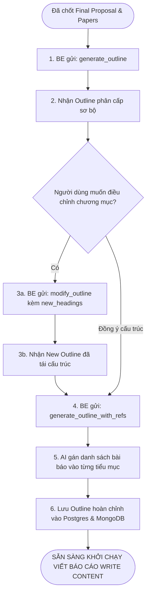

# 📑 ĐẶC TẢ TÍNH NĂNG: ĐỀ CƯƠNG CHI TIẾT & ÁNH XẠ TÀI LIỆU (DOC SETUP)

> Thuộc phân hệ: **Document Setup Service (Service 1 - Nhóm Outlines & Citations)**  
> Tham chiếu: [KAFKA_FULL_SCHEMA_AND_WORKFLOW.md (Mục 6.11 - 6.14)](file:///home/hiubao/Projects/03_Work/Company/auto-research-be/KAFKA_FULL_SCHEMA_AND_WORKFLOW.md)  
> Kafka Topics: `document_setup_request` ➡️ `document_setup_response` *(hoặc `_local`)*

---

## 1. Mô tả chức năng
Đóng vai trò then chốt trước khi bước vào giai đoạn Viết báo cáo:
- Tự động sinh cấu trúc đề cương nghiên cứu phân cấp (Chương, Tiêu đề 1, Tiêu đề 2, Tiêu đề 3) theo tỷ trọng phân bổ số từ và phương pháp luận (`generate_outline`).
- Cho phép người dùng chỉnh sửa, thêm/bớt chương mục và tự động tái cân bằng nội dung (`modify_outline`).
- Ánh xạ thông minh các bài báo khoa học đã chuẩn bị vào từng tiểu mục đề cương (`generate_outline_with_refs`), đảm bảo mỗi luận điểm đều có trích dẫn khoa học minh chứng.
- Tự động cập nhật quan hệ tài liệu tham khảo vào MongoDB `reports_refs` (`update_user_refs`).

---

## 2. Đặc tả Input (100% Request Fields)

| Event Type | Trường bắt buộc | Trường tùy chọn | Mô tả chi tiết dữ liệu gửi vào Kafka |
|---|---|---|---|
| `generate_outline` | `field` (str), `domain` (str), `research_type` (dict: type 0\|1\|2, reason), `word_count_str` (str, vd: "15000-20000 words"), `headings` (list[dict]), `headings_percent` (list[int]), `final_proposal` (dict), `outline_code` (list[str]) | - | Sinh đề cương hoàn chỉnh dựa trên đề tài đã chốt và cấu trúc chương chính. |
| `modify_outline` | `field`, `domain`, `research_type`, `final_proposal`, `headings` (list[str]), `headings_percent` (list[int]), `new_headings` (list[str]), `new_headings_percent` (list[int]) | - | Tái cân bằng cấu trúc và phân bổ số từ sau khi người dùng điều chỉnh mục. |
| `generate_outline_with_refs` | `outline` (dict), `outline_code` (list[str]), `final_proposal` (dict), `processed_docs` (list[dict]) | - | Gán danh sách bài báo phù hợp nhất vào từng tiểu mục của đề cương. |
| `update_user_refs` | `documents` (list[dict]) | - | Cập nhật ánh xạ khi thêm bớt tài liệu tham khảo (lưu vào MongoDB `reports_refs`). |

---

## 3. Đặc tả Output (100% Response Fields & Database Sync)

```json
// generate_outline_with_refs response
{
  "event_type": "generate_outline_with_refs",
  "document_id": "doc-uuid",
  "outline": {
    "title": "Ứng dụng AI trong Chẩn đoán Y tế Tuyến cơ sở",
    "outline": [
      {
        "chapter": "chapter_1",
        "title": "CHƯƠNG 1: TỔNG QUAN VẤN ĐỀ NGHIÊN CỨU",
        "sections": [
          {
            "section_code": "1.1",
            "name": "1.1. Tính cấp thiết của đề tài",
            "description": "Phân tích thực trạng thiếu hụt nhân lực y tế...",
            "refs": [
              {
                "title": "Deep Learning for Medical Diagnosis",
                "authors": "John Doe et al.",
                "year": 2024,
                "journal": "Nature Medicine",
                "url": "https://doi.org/..."
              }
            ]
          }
        ]
      }
    ]
  },
  "input_tokens": 2500,
  "output_tokens": 4000
}
```

**Đồng bộ cơ sở dữ liệu:**
- Lưu toàn bộ cây đề cương vào bảng `outlines` trong PostgreSQL (`structure`: JSON chứa cây mục và `refs`, `outlineCode`, `headings`, `headingsPercent`, `totalWordCount`).
- AI đồng thời tự động cập nhật vào MongoDB collection `user_documents.reports_refs`.

---

## 4. Luồng hoạt động (Workflow Flowchart)


