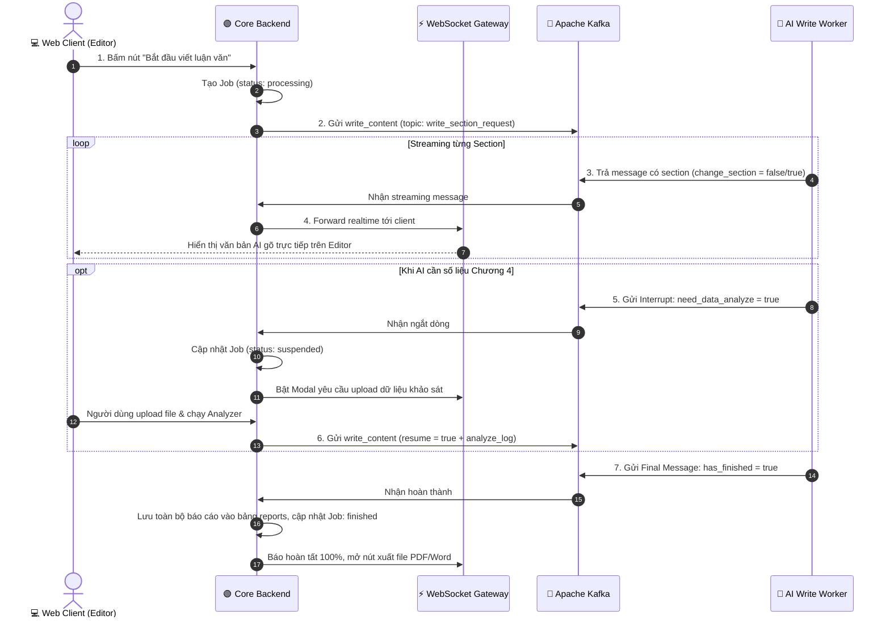

# ✍️ ĐẶC TẢ TÍNH NĂNG: VIẾT BÁO CÁO STREAMING & XỬ LÝ NGẮT DÒNG (WRITE SECTION)

> Thuộc phân hệ: **Write Section & Data Analysis Service (Service 2 - Core Writing Engine)**  
> Tham chiếu: [KAFKA_FULL_SCHEMA_AND_WORKFLOW.md (Mục 7.1, 7.3, 10.1)](file:///home/hiubao/Projects/03_Work/Company/auto-research-be/KAFKA_FULL_SCHEMA_AND_WORKFLOW.md)  
> Kafka Topics: `write_section_request` ➡️ `write_section_response` *(hoặc `_local`)*

---

## 1. Mô tả chức năng
Tác vụ cốt lõi nhất của toàn bộ hệ thống:
- AI đọc toàn bộ đề cương, truy vấn dữ liệu từ Qdrant RAG và viết nội dung chi tiết cho từng tiểu mục của luận văn/báo cáo (`write_content`, `chuyen_de_1`, `chuyen_de_2`).
- Cơ chế **Streaming liên tục**: trả về từng đoạn văn bản kèm trích dẫn chuẩn APA/IEEE theo thời gian thực tới trình duyệt của người dùng.
- Cơ chế **Ngắt dòng (Interrupt)**: AI tự động phát hiện khi viết đến phần số liệu khảo sát thực tế (Chương 4) hoặc phương pháp để tạm ngắt và đợi người dùng cung cấp thêm dữ liệu phân tích.
- Cơ chế **Resume**: Khôi phục lại đúng trạng thái đang ngắt bằng `thread_id` trong Redis Checkpoint để viết tiếp mà không phải viết lại từ đầu.

---

## 2. Đặc tả Input (100% Request Fields)

```json
{
  "event_type": "write_content", // hoặc chuyen_de_1, chuyen_de_2
  "model_id": "localhost",
  "user_id": "user-uuid",
  "document_id": "doc-uuid",
  "session_id": "sess-uuid",
  "language": "Vietnamese",
  "field": "Kinh tế",
  "domain": "Thương mại điện tử",
  "references_style": "APA",
  "final_proposal": { "title": "...", "problem_statement": "..." },
  "papers_search": [{ "title": "...", "authors": "...", "year": 2024 }],
  "outline": { "title": "...", "outline": [...] },
  "outline_code": ["chapter_1", "chapter_2", "chapter_3", "chapter_4", "chapter_5"],
  "thread_id": "thread-langgraph-uuid",
  "db": "redis",
  "retry": 2,
  "use_web_search": false,
  
  // Cờ Resume (Bật tối đa 1 cờ = true)
  "resume": false,             // Bật khi bổ sung kết quả phân tích số liệu
  "resume_error": false,       // Bật khi thử lại sau lỗi mạng/timeout
  "resume_method": false,      // Bật sau khi chốt mô hình và thang đo
  "resumeCharacter": false,    // Bật khi tiếp tục viết chương kế tiếp
  
  // Dữ liệu bổ sung khi resume = true
  "analyze_log": "Tóm tắt kết quả phân tích dữ liệu SPSS...",
  "detailed_logs": [{ "table_name": "Cronbach Alpha", "data": [...] }],
  "generated_files": { "chart_1": "https://minio.../plot.png" }
}
```

---

## 3. Đặc tả Output (Streaming, Interrupt & Final Message)

### 3.1. Tin nhắn Streaming (Nhận nhiều lần trên Kafka Response)
```json
{
  "event_type": "write_content",
  "document_id": "doc-uuid",
  "thread_id": "thread-langgraph-uuid",
  "section": {
    "name": "1.1. Tính cấp thiết của đề tài",
    "section_code": "1.1",
    "content": "<p>Trong bối cảnh kỷ nguyên số bùng nổ, việc ứng dụng trí tuệ nhân tạo...</p>",
    "refs": [{ "title": "Deep Learning...", "citation": "(Doe et al., 2024)" }]
  },
  "change_section": false, // true = hoàn tất mục này, chuẩn bị sang mục mới
  "index": 1729342500.12
}
```

### 3.2. Tin nhắn Ngắt dòng (Interrupt Message)
```json
{
  "event_type": "write_content",
  "document_id": "doc-uuid",
  "thread_id": "thread-langgraph-uuid",
  "need_data_analyze": true,   // Yêu cầu người dùng chạy phân tích số liệu
  "need_propose_method": false,
  "disable_edit": true
}
```

### 3.3. Tin nhắn Hoàn tất toàn bộ (Final Message)
```json
{
  "event_type": "write_content",
  "document_id": "doc-uuid",
  "has_finished": true,
  "input_tokens": 18500,
  "output_tokens": 32000,
  "embed_tokens": 4500
}
```

**Đồng bộ cơ sở dữ liệu:**
- Khi nhận `section`: Forward ngay lập tức qua WebSocket tới Web Client.
- Khi nhận `need_data_analyze = true`: Đổi trạng thái `Job` thành `suspended`, lưu `threadId`.
- Khi nhận `has_finished = true`: Đổi `Job` thành `finished`, lưu toàn văn vào bảng `reports` (`contentMarkdown`, `version`).

---

## 4. Luồng hoạt động (Workflow Sequence)


