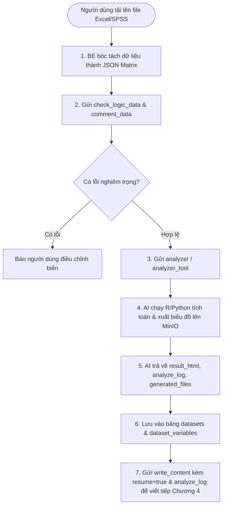

# 📊 ĐẶC TẢ TÍNH NĂNG: PHÂN TÍCH SỐ LIỆU THỐNG KÊ SPSS / PLS-SEM (WRITE SECTION)

> Thuộc phân hệ: **Write Section & Data Analysis Service (Service 2 - Data Engine)**  
> Tham chiếu: [KAFKA_FULL_SCHEMA_AND_WORKFLOW.md (Mục 7.2, 7.4, 7.7, 7.8)](file:///home/hiubao/Projects/03_Work/Company/auto-research-be/KAFKA_FULL_SCHEMA_AND_WORKFLOW.md)  
> Kafka Topics: `write_section_request` ➡️ `write_section_response` *(hoặc `_local`)*

---

## 1. Mô tả chức năng
Cung cấp công cụ phân tích dữ liệu định lượng tự động và chuyên sâu:
- Phân tích thống kê mô tả, Cronbach's Alpha, EFA, Hồi quy OLS, Mô hình cấu trúc tuyến tính PLS-SEM (`analyzer`, `analyzer_tool`).
- Viết Chuyên đề 3 tích hợp cả 2 giai đoạn: vừa phân tích số liệu vừa viết báo cáo kết quả thực nghiệm (`chuyen_de_3`).
- Đánh giá sơ bộ chất lượng biến và độ tin cậy của tập dữ liệu khảo sát (`comment_data`).
- Kiểm tra logic giữa các biến độc lập, trung gian, phụ thuộc và thang đo (`check_logic_data`).

---

## 2. Đặc tả Input (100% Request Fields)

| Event Type | Trường bắt buộc | Trường tùy chọn | Mô tả chi tiết dữ liệu gửi vào Kafka |
|---|---|---|---|
| `analyzer` & `analyzer_tool` | `conv_id` (str), `thread_id` (str), `final_proposal` (dict), `data` (dict: key là tên cột, value là mảng giá trị), `variables` (list[dict]) | `auto_plan_mode` (bool, def: true), `auto_action_mode` (bool, def: true), `manual_plan_mode` (bool), `tool_configs`, `resume` (bool), `feedback` (str), `db: "redis"` | Chạy phân tích thống kê tự động hoặc theo kịch bản tùy chỉnh của người dùng. |
| `chuyen_de_3` | Toàn bộ tham số của `analyzer` + toàn bộ tham số của `write_content` (`outline`, `papers_search`, `references_style`) | `write_resume_error` (bool) | Tích hợp phân tích dữ liệu và viết toàn bộ Chuyên đề 3. |
| `comment_data` | `final_proposal`, `data` (dict), `variables` (list[dict]), `thread_id` (str) | - | Nhận xét tính hợp lệ của dữ liệu với từng biến nghiên cứu. |
| `check_logic_data` | `variables` (list[dict]) | - | Kiểm tra mâu thuẫn logic và lỗi thang đo Likert. |

---

## 3. Đặc tả Output (100% Response Fields & Database Sync)

```json
// analyzer & analyzer_tool response
{
  "event_type": "analyzer",
  "document_id": "doc-uuid",
  "thread_id": "thread-analysis-uuid",
  "has_finished": true,
  "result_html": "<div class='analysis-report'><h3>Kết quả Cronbach's Alpha</h3><table>...</table></div>",
  "analyze_log": "Tất cả 5 thang đo đều đạt độ tin cậy Alpha > 0.8. Thang đo F1 có biến quan sát f1_4 bị loại do tương quan biến tổng < 0.3...",
  "detailed_logs": [
    {
      "test_name": "Cronbach's Alpha",
      "p_value": 0.001,
      "f2": 0.15,
      "r2": 0.62,
      "vif": 1.45
    }
  ],
  "generated_files": {
    "pls_sem_model": "https://minio.local/auto-research/charts/sem_model.png"
  },
  "current_variables": [
    { "name": "F1", "role": "Independent", "retained_items": ["f1_1", "f1_2", "f1_3"] }
  ],
  "input_tokens": 4500,
  "output_tokens": 8000
}
```

```json
// check_logic_data response
{
  "event_type": "check_logic_data",
  "errors_logic": ["Biến phụ thuộc Y bị gán nhầm làm biến độc lập trong giả thuyết H2"],
  "warnings_logic": ["Thang đo biến M chỉ có 2 biến quan sát, khuyến nghị tối thiểu 3"]
}
```

**Đồng bộ cơ sở dữ liệu:**
- Lưu kết quả phân tích trực quan vào bảng `datasets` (`analysisResults`: `result_html`, `analyzeLog`, `detailedLogs`, `generatedFiles`).
- Cập nhật các biến đã tinh lọc vào bảng `dataset_variables`.
- `analyze_log` sẵn sàng được sử dụng để kích hoạt resume tác vụ `write_content`.

---

## 4. Luồng hoạt động (Workflow Flowchart)


