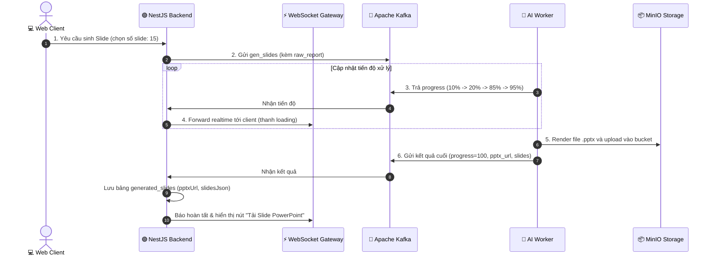

# 📊 ĐẶC TẢ TÍNH NĂNG: TƯ VẤN PHƯƠNG PHÁP, SLIDE PPTX & DỊCH THUẬT

> Thuộc phân hệ: **Write Section & Data Analysis Service (Service 2 - Extended Features)**  
> Tham chiếu: [KAFKA_FULL_SCHEMA_AND_WORKFLOW.md (Mục 7.5, 7.6, 7.9, 7.10)](file:///home/hiubao/Projects/03_Work/Company/auto-research-be/KAFKA_FULL_SCHEMA_AND_WORKFLOW.md)  
> Kafka Topics: `write_section_request` ➡️ `write_section_response` *(hoặc `_local`)*

---

## 1. Mô tả chức năng
Mở rộng khả năng của hệ thống phục vụ báo cáo và bảo vệ công trình nghiên cứu:
- **Tư vấn phương pháp nghiên cứu đa lượt (`propose_method`)**: AI đóng vai trò hội đồng khoa học, phỏng vấn người dùng để xây dựng mô hình nghiên cứu (Research Model), giả thuyết, ma trận biến và bộ câu hỏi khảo sát thang đo Likert hoàn chỉnh.
- **Tự động sinh Slide thuyết trình PowerPoint (`gen_slides`)**: Tóm tắt toàn văn báo cáo thành các slide chuyên nghiệp, phát tiến trình xử lý real-time và xuất file `.pptx` lên MinIO.
- **Dịch thuật song ngữ (`translate_report`)**: Dịch toàn bộ báo cáo hoặc đề cương sang ngôn ngữ khác (Anh - Việt).
- **Dọn dẹp triệt để (`delete_report`)**: Xóa toàn bộ dữ liệu báo cáo khỏi PostgreSQL, MongoDB, Qdrant và Redis.

---

## 2. Đặc tả Input (100% Request Fields)

| Event Type | Trường bắt buộc | Trường tùy chọn | Mô tả chi tiết dữ liệu gửi vào Kafka |
|---|---|---|---|
| `propose_method` | `thread_id` (str), `conv_id` (str), `research_type` (dict), `final_proposal` (dict) | `user_input` (str), `auto_mode` (bool), `inherit_mode` (bool), `resume_method` (bool), `db: "redis"` | Hội thoại đa lượt tương tác thiết kế mô hình & bảng hỏi khảo sát. |
| `gen_slides` | `raw_report` (str: nội dung báo cáo HTML/Markdown), `user_preference` (int: 15 hoặc 20 slides) | `manual_mode` (bool), `resume_error` (bool) | Tự động sinh bài trình chiếu PowerPoint kèm speaker notes. |
| `translate_report` | `target_language` (str, vd: "English"), `is_outline` (bool) | - | Dịch thuật toàn bộ báo cáo hoặc đề cương. |
| `delete_report` | `document_id` (list[str]), `thread_id` (list[str]) | - | Xóa sạch toàn bộ tài nguyên liên quan tới báo cáo. |

---

## 3. Đặc tả Output (100% Response Fields & Database Sync)

```json
// propose_method response (khi hoàn thành chốt mô hình)
{
  "event_type": "propose_method",
  "document_id": "doc-uuid",
  "has_finished": true,
  "final_proposal": {
    "final_model": { "type": "Structural Equation Modeling", "factors": ["PEOU", "PU", "BI"] },
    "hypothesis": [{ "id": "H1", "content": "PEOU tác động tích cực đến PU" }],
    "variables": [{ "name": "PEOU", "scale": "Likert 5", "items": ["peou_1", "peou_2"] }],
    "survey_questions": [{ "item": "peou_1", "question": "Hệ thống dễ sử dụng", "source": "Davis (1989)" }],
    "questions": ["Các yếu tố nào thúc đẩy chấp nhận công nghệ?"]
  }
}
```

```json
// gen_slides response (khi tiến độ đạt 100%)
{
  "event_type": "gen_slides",
  "document_id": "doc-uuid",
  "progress": 100,
  "has_finished": true,
  "slides": [
    {
      "slide_number": 1,
      "title": "Tổng quan Nghiên cứu",
      "bullet_points": ["Tính cấp thiết", "Mục tiêu nghiên cứu"],
      "speaker_notes": "Kính thưa quý thầy cô trong hội đồng..."
    }
  ],
  "pptx_url": "https://minio.local/auto-research/slides/presentation_doc123.pptx"
}
```

**Đồng bộ cơ sở dữ liệu:**
- `propose_method`: Lưu vào bảng `proposed_methods` và đồng bộ vào trường `finalModel`, `hypothesis`, `surveyQuestions` của bảng `proposals`.
- `gen_slides`: Cập nhật bảng `generated_slides` (`status: completed`, `pptxUrl`, `slidesJson`).

---

## 4. Luồng hoạt động (Workflow Sequence)


