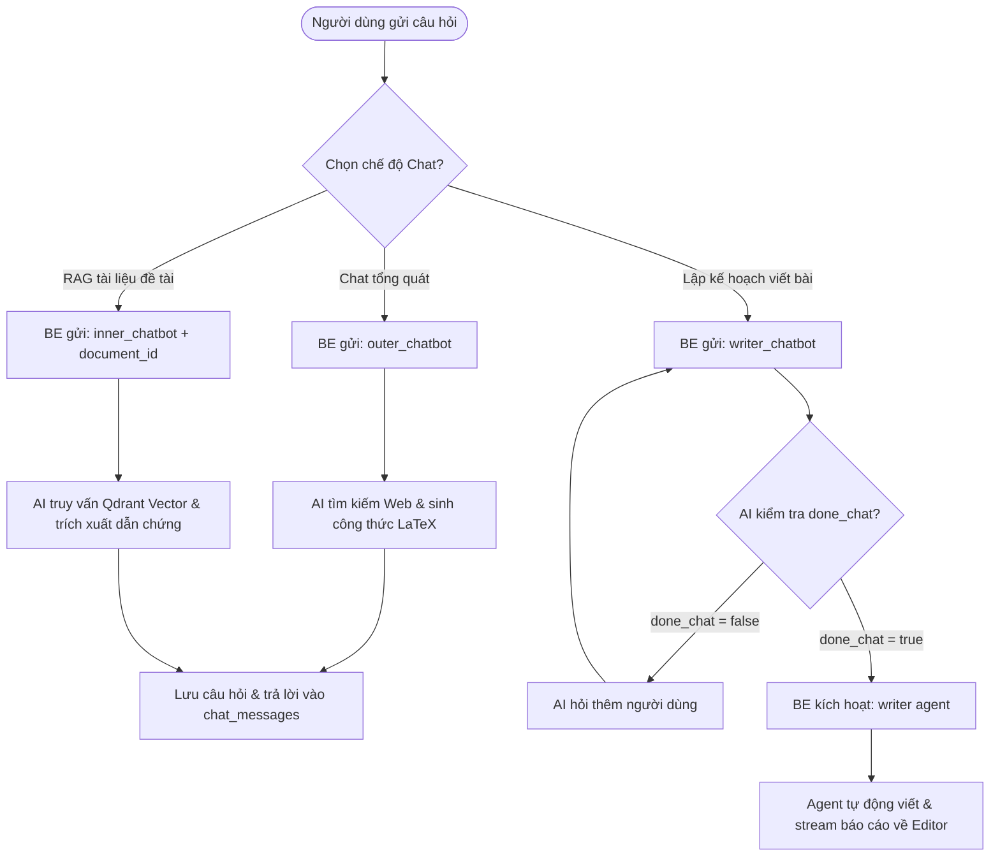

# 💬 ĐẶC TẢ TÍNH NĂNG: AI CHATBOT HỌC THUẬT & AGENT VIẾT TỰ ĐỘNG

> Thuộc phân hệ: **AI Chatbot & Writer Agent Service (Service 3)**  
> Tham chiếu: [KAFKA_FULL_SCHEMA_AND_WORKFLOW.md (Mục 8.1 - 8.4)](file:///home/hiubao/Projects/03_Work/Company/auto-research-be/KAFKA_FULL_SCHEMA_AND_WORKFLOW.md)  
> Kafka Topics: `chatbot_request` ➡️ `chatbot_response` *(hoặc `_local`)*

---

## 1. Mô tả chức năng
Cung cấp giải pháp trợ lý đàm thoại học thuật thông minh và tác nhân tự động:
- **Outer Chatbot (`outer_chatbot`)**: Trợ lý giải đáp kiến thức khoa học tổng quát, tra cứu web Google thời gian thực, hỗ trợ hiển thị công thức toán học LaTeX chuẩn `$ ... $`, `$$ ... $$` và code block.
- **Inner Chatbot (`inner_chatbot`)**: Trợ lý RAG chuyên sâu, trả lời chính xác dựa trên tài liệu bài báo khoa học và file PDF đã nạp vào Qdrant của đề tài.
- **Writer Chatbot (`writer_chatbot`)**: Phỏng vấn tương tác nhiều lượt để chốt đề cương và các điều kiện trước khi viết.
- **Writer Agent (`writer`)**: Agent tự động duyệt web, tìm kiếm tài liệu và viết toàn văn báo cáo streaming độc lập.

---

## 2. Đặc tả Input (100% Request Fields)

| Event Type | Trường bắt buộc | Trường tùy chọn | Mô tả chi tiết dữ liệu gửi vào Kafka |
|---|---|---|---|
| `outer_chatbot` | `conv_id` (str), `question` (str), `chat_history` (list[dict: role, content]) | `short_answer` (bool), `direct_answer` (bool), `use_web_search_chatbot` (bool) | Trò chuyện học thuật tổng quát, tra cứu Google khi cần. |
| `inner_chatbot` | `document_id` (str), `conv_id` (str), `question` (str), `chat_history` (list[dict]) | `short_answer` (bool), `direct_answer` (bool), `use_web_search_chatbot` (bool) | Chatbot RAG dựa trên collection `{document_id}` và `{document_id}_user` trong Qdrant. |
| `writer_chatbot` | `conv_id` (str), `question` (str), `resume` (bool: false câu đầu, true câu sau) | `short_answer` (bool), `template_key` (str) | Tư vấn đa lượt chốt kế hoạch viết bài. |
| `writer` | `chat_history` (str), `summary` (dict), `outline` (str), `domain` (str), `field` (str) | `notes` (list[str]), `use_web_search` (bool), `max_research_iterations` (int, def: 3) | Agent viết bài tự động hoàn toàn theo kế hoạch. |

---

## 3. Đặc tả Output (100% Response Fields & Database Sync)

```json
// outer_chatbot & inner_chatbot response
{
  "event_type": "outer_chatbot",
  "conv_id": "conv-uuid",
  "user_id": "user-uuid",
  "response": "Phương trình hồi quy tuyến tính mẫu có dạng: $$ Y = \\beta_0 + \\beta_1 X_1 + \\epsilon $$ Trong đó, hệ số $\\beta_1$ phản ánh...",
  "functionality_error": false,
  "input_tokens": 650,
  "output_tokens": 1200,
  "web_search_call": 1
}
```

```json
// writer_chatbot response (khi chốt xong kế hoạch)
{
  "event_type": "writer_chatbot",
  "conv_id": "conv-uuid",
  "done_chat": true,
  "chat_history": "Tổng hợp quá trình trao đổi...",
  "summary": { "target_words": 10000, "tone": "academic", "methodology": "mixed" },
  "outline": "Đề cương chi tiết đã thống nhất...",
  "template_key": "standard_thesis"
}
```

**Đồng bộ cơ sở dữ liệu:**
- `outer_chatbot` & `inner_chatbot`: Lưu tin nhắn vào bảng `chat_messages` thuộc phiên `chat_sessions` (mode: `outer_chatbot` hoặc `inner_chatbot`).
- `writer_chatbot`: Lưu `summary` và `outline` vào bảng `chat_sessions`.
- `writer`: Streaming sections tương tự `write_content`, khi `has_finished = true` thì lưu báo cáo hoàn chỉnh vào bảng `reports`.

---

## 4. Luồng hoạt động (Workflow Flowchart)


