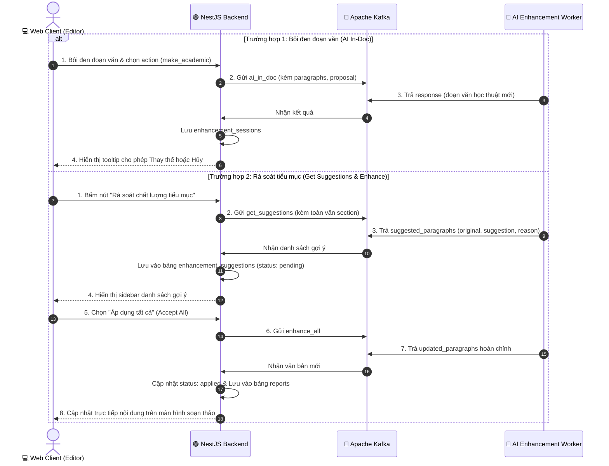

# ✂️ ĐẶC TẢ TÍNH NĂNG: AI IN-DOC EDITOR & TRỢ LÝ ĐỀ XUẤT CẢI TIẾN (ENHANCEMENT)

> Thuộc phân hệ: **Enhancement & In-Doc AI Service (Service 4)**  
> Tham chiếu: [KAFKA_FULL_SCHEMA_AND_WORKFLOW.md (Mục 9.1 - 9.4)](file:///home/hiubao/Projects/03_Work/Company/auto-research-be/KAFKA_FULL_SCHEMA_AND_WORKFLOW.md)  
> Kafka Topics: `enhancement_request` ➡️ `enhancement_response` *(hoặc `_local`)*

---

## 1. Mô tả chức năng
Cung cấp giải pháp AI biên tập trực tiếp trong trình soạn thảo văn bản:
- **AI Inline Assistant (`ai_in_doc`)**: Người dùng bôi đen đoạn văn bản và chọn hành động: viết lại (`rewrite`), mở rộng ý (`expand`), rút gọn súc tích (`shorten`), học thuật hóa văn phong (`make_academic`), sửa lỗi ngữ pháp & chính tả (`fix_grammar`).
- **Rà soát & Đề xuất Cải tiến (`get_suggestions`)**: Quét toàn bộ tiểu mục, phát hiện lập luận yếu hoặc thiếu bằng chứng, trả về danh sách đối chiếu đoạn cũ - đoạn mới kèm lý do.
- **Áp dụng Gợi ý (`enhance`, `enhance_all`)**: Thay thế mượt mà 1 hoặc toàn bộ các gợi ý đã duyệt vào nội dung báo cáo mà không phá vỡ cấu trúc văn bản.

---

## 2. Đặc tả Input (100% Request Fields)

| Event Type | Trường bắt buộc | Trường tùy chọn | Mô tả chi tiết dữ liệu gửi vào Kafka |
|---|---|---|---|
| `ai_in_doc` | `section_id` (str), `paragraphs` (str: đoạn văn bôi đen), `action` ("rewrite"\|"expand"\|"shorten"\|"make_academic"\|"fix_grammar"), `proposal` (dict) | `paragraph_context` (str: ngữ cảnh xung quanh) | Xử lý nhanh đoạn văn được chọn bám sát đề tài nghiên cứu. |
| `get_suggestions` | `section` (str: toàn văn tiểu mục), `section_context` (str: tiêu đề tiểu mục & chương) | `processed_docs` (list[dict]: tài liệu tham khảo đã gán) | Rà soát phát hiện các điểm cần nâng cấp câu từ. |
| `enhance` | `section` (str), `suggested_paragraph` (dict: `{"original": "...", "suggestion": "..."}`) | - | Áp dụng 1 gợi ý cụ thể vào toàn bộ văn bản tiểu mục. |
| `enhance_all` | `section` (str), `suggested_paragraphs` (list[dict]) | - | Áp dụng đồng loạt danh sách các gợi ý đã được chấp nhận. |

---

## 3. Đặc tả Output (100% Response Fields & Database Sync)

```json
// ai_in_doc response
{
  "event_type": "ai_in_doc",
  "document_id": "doc-uuid",
  "section_id": "sec-1.1",
  "response": "Đoạn văn sau khi được chuyển đổi sang văn phong học thuật chuyên sâu...",
  "input_tokens": 400,
  "output_tokens": 600
}
```

```json
// get_suggestions response
{
  "event_type": "get_suggestions",
  "document_id": "doc-uuid",
  "suggested_paragraphs": [
    {
      "original": "Nhiều người dùng cảm thấy phần mềm này rất khó sử dụng và thường xuyên gặp lỗi.",
      "suggestion": "Khảo sát thực nghiệm cho thấy trải nghiệm người dùng chưa đạt mức tối ưu, với tỷ lệ phản hồi về rào cản thao tác chiếm 42.5%.",
      "reason": "Văn phong văn nói, thiếu số liệu định lượng và tính khách quan khoa học."
    }
  ],
  "disable_edit": false,
  "input_tokens": 1500,
  "output_tokens": 2200
}
```

```json
// enhance & enhance_all response
{
  "event_type": "enhance",
  "document_id": "doc-uuid",
  "updated_paragraphs": "Toàn bộ văn bản tiểu mục sau khi đã được thay thế mượt mà...",
  "input_tokens": 1200,
  "output_tokens": 1600
}
```

**Đồng bộ cơ sở dữ liệu:**
- `ai_in_doc`: Lưu vào bảng `enhancement_sessions` (`selectedText`, `contextText`, `enhancementType`).
- `get_suggestions`: Lưu các bản ghi gợi ý vào bảng `enhancement_suggestions` (`status: pending`).
- `enhance` & `enhance_all`: Cập nhật trạng thái gợi ý thành `applied`, đồng thời cập nhật nội dung văn bản mới vào bảng `reports`.

---

## 4. Luồng hoạt động (Workflow Sequence)


