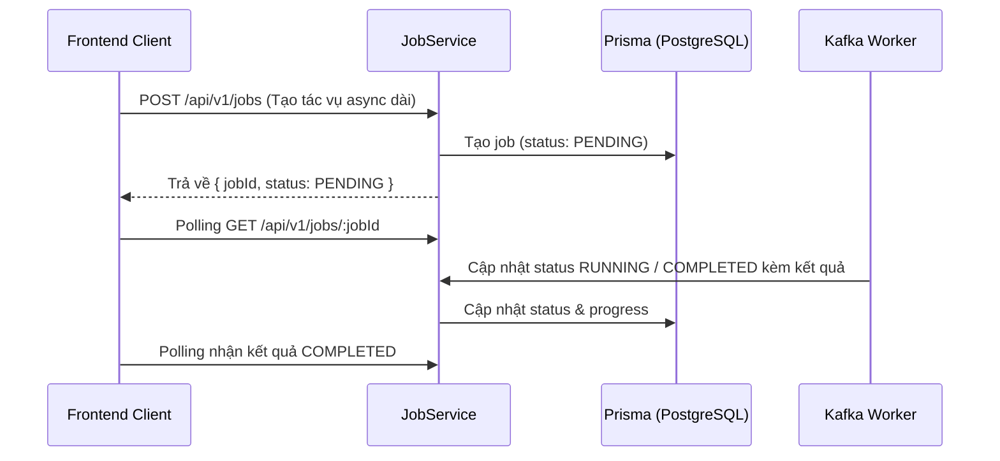

# ⚙️ Module: Async Jobs & Resume Management

## Mục đích
Quản lý vòng đời của các tác vụ AI bất đồng bộ kéo dài (tải PDF, sinh embedding, sinh toàn bộ đề cương, phân tích thống kê PLS-SEM, xuất slide). Hỗ trợ cơ chế tiếp tục tiến trình (`resumeJob`) từ checkpoint gần nhất (`resumeStep`) khi bị gián đoạn.

---

## Các thành phần chính

- `JobController` (`src/modules/jobs/job.controller.ts`):
  - `POST /api/v1/jobs`: Tạo một job mới cho tác vụ async
  - `GET /api/v1/jobs/:id`: Kiểm tra trạng thái hiện tại (tiến độ %, status, kết quả, log)
  - `PATCH /api/v1/jobs/:id/status`: Cập nhật trạng thái job (PENDING, RUNNING, COMPLETED, FAILED)
  - `POST /api/v1/jobs/:id/resume`: Tiếp tục thực thi job từ bước lưu gần nhất
- `JobService` (`src/modules/jobs/job.service.ts`):
  - Quản lý trạng thái job, lưu trữ log chi tiết và checkpoint trung gian
  - Đóng gói logic retry và phục hồi trạng thái
- DTOs (`src/modules/jobs/dto/`):
  - `CreateJobDto`: Khai báo loại tác vụ, metadata đầu vào và liên kết tài liệu
  - `ResumeJobDto`: Chỉ định bước (`resumeStep`) cần tiếp tục
  - `UpdateJobStatusDto`: Đồng bộ trạng thái từ worker AI

---

## Luồng dữ liệu

---

## Dependencies

- **Phụ thuộc vào**:
  - `PrismaService`: Lưu trữ thông tin tiến trình bảng `Job`
  - `MessagingModule`: Tiếp nhận các event kết quả từ Kafka Response topics
- **Được sử dụng bởi**:
  - Toàn bộ các module kích hoạt tác vụ nền AI (`DocumentSetup`, `WriteReport`)

---

## Edge cases & Lưu ý

- Trạng thái `FAILED`: Cần ghi nhận rõ nguyên nhân lỗi (error message / stack) để người dùng có thể debug hoặc bấm Retry.
- Polling quá nhiều từ Client: Cần hỗ trợ rate limiting hoặc khuyến khích interval tối thiểu 2-3 giây mỗi lần poll.
- Checkpoint `resumeStep` phải tương thích với trạng thái node trong LangGraph Checkpoint của AI Service.

---

## Cập nhật lần cuối
2026-10-19 — Khởi tạo tài liệu module theo chuẩn `rules/rule-docs.md`.
