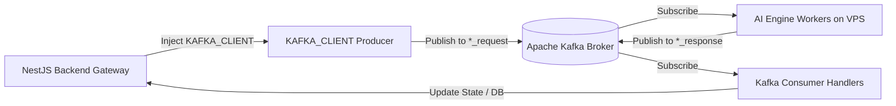

# 📡 Module: Messaging (Kafka & Redis)

## Mục đích
Quản lý hạ tầng giao tiếp phân tán: kết nối Apache Kafka để gửi nhận message bất đồng bộ giữa Gateway Backend và 4 AI Microservices, cùng Redis Client phục vụ caching, rate limiting và quản lý trạng thái phiên.

---

## Các thành phần chính

- `MessagingModule` (`src/messaging/messaging.module.ts`):
  - Khởi tạo `@Global()` module cho Kafka Client và Redis Client
  - Đăng ký `ClientsModule.registerAsync` với `Transport.KAFKA`
- `messaging.tokens.ts` (`src/common/messaging.tokens.ts`):
  - Định nghĩa Injection Tokens: `KAFKA_CLIENT` và `REDIS_CLIENT`
- Cấu hình Kafka (`src/config/kafka.config.ts`):
  - Đọc biến môi trường `KAFKA_BROKERS`, `KAFKA_CLIENT_ID`, `KAFKA_GROUP_ID`, `KAFKA_SSL`
  - Cơ chế tự động thêm hậu tố `_local` cho topics khi chạy môi trường dev cục bộ
- Danh sách 4 cặp Kafka Topics:
  1. `document_setup_request` / `document_setup_response`
  2. `write_section_request` / `write_section_response`
  3. `chatbot_request` / `chatbot_response`
  4. `enhancement_request` / `enhancement_response`

---

## Luồng dữ liệu

---

## Dependencies

- **Phụ thuộc vào**:
  - `@nestjs/microservices`, `kafkajs`, `ioredis`
  - `kafkaConfig`, `redisConfig` từ `@nestjs/config`
- **Được sử dụng bởi**:
  - `DocumentSetupModule`, `WriteReportModule`, `ChatbotModule`, `EnhancementModule`, `JobsModule`

---

## Edge cases & Lưu ý

- `allowAutoTopicCreation` được đặt thành `false` ở cả producer và consumer để kiểm soát chặt chẽ danh sách topics.
- Phải đảm bảo broker Kafka đã được cấp chứng chỉ SSL khi kết nối tới VPS staging/production.
- Graceful shutdown: Cần ngắt kết nối Kafka producer/consumer khi ứng dụng dừng để không bị kẹt partition rebalancing.

---

## Cập nhật lần cuối
2026-10-19 — Khởi tạo tài liệu module theo chuẩn `rules/rule-docs.md`.
