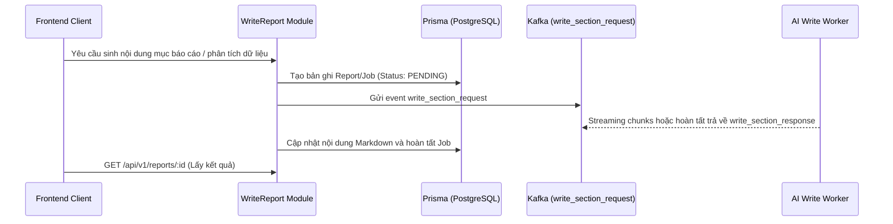

# ✍️ Module: Write Report & Data Analysis

## Mục đích
Quản lý quá trình sinh báo cáo/luận văn nghiên cứu khoa học: soạn thảo nội dung báo cáo dạng Markdown, phân tích tập dữ liệu (dataset), biến nghiên cứu (dataset variables), phương pháp đề xuất (proposed method), và sinh slide thuyết trình (generated slides).

---

## Các thành phần chính

- `ReportController` & `ReportService` (`src/modules/write-report/report/`):
  - CRUD báo cáo nghiên cứu và các section nội dung
  - Hỗ trợ endpoint gắn tài liệu (`document-report.controller.ts`)
- `DatasetController` & `DatasetService` (`src/modules/write-report/dataset/`):
  - Quản lý metadata và file dữ liệu thực nghiệm (CSV, Excel) phục vụ phân tích định lượng
- `DatasetVariableController` & `DatasetVariableService` (`src/modules/write-report/dataset-variable/`):
  - Quản lý các biến nghiên cứu độc lập, phụ thuộc, trung gian và thang đo
- `ProposedMethodController` & `ProposedMethodService` (`src/modules/write-report/proposed-method/`):
  - Quản lý mô tả phương pháp nghiên cứu, thuật toán, khung lý thuyết phân tích
- `GeneratedSlideController` & `GeneratedSlideService` (`src/modules/write-report/generated-slide/`):
  - Quản lý kết quả slide trình chiếu (PPTX/HTML) sinh tự động từ nội dung báo cáo

---

## Luồng dữ liệu

---

## Dependencies

- **Phụ thuộc vào**:
  - `PrismaService`: Quản lý lưu trữ bảng `Report`, `Dataset`, `DatasetVariable`, `ProposedMethod`, `GeneratedSlide`
  - `DocumentSetupModule`: Đọc ngữ cảnh Outline và Reference
  - `MessagingModule`: Điều phối event Kafka sang AI Write Section Worker
  - `JobsModule`: Theo dõi tiến trình tạo báo cáo và slide
- **Được sử dụng bởi**:
  - `EnhancementModule`: Cung cấp nội dung văn bản để AI trau chuốt và viết lại

---

## Edge cases & Lưu ý

- Nội dung bài viết dài cần chia nhỏ theo từng section/tiểu mục để tránh payload vượt ngưỡng Kafka và timeout HTTP.
- Kết quả slide (.pptx) lưu trữ tại MinIO/S3, trong DB chỉ lưu URL tải và metadata.
- Tập dữ liệu lớn (dataset) cần kiểm tra kích thước và định dạng cột trước khi kích hoạt worker phân tích.

---

## Cập nhật lần cuối
2026-10-19 — Khởi tạo tài liệu module theo chuẩn `rules/rule-docs.md`.

---

## Cập nhật 2026-10-23 — API `translate_report`

`POST /documents/:documentId/translate-report` (JWT)

| Field | Kiểu | Ghi chú |
|---|---|---|
| `targetLanguage` | string (bắt buộc) | Chuỗi tự do ("English", "Tiếng Việt") — AI nhúng vào prompt |
| `isOutline` | boolean (mặc định `false`) | `true` ⇒ dịch đề cương, `false` ⇒ dịch toàn văn |

- AI **không** trả nội dung bản dịch qua Kafka; AI ghi vào Mongo `admin.document_configurations`:
  `translatedContent` (toàn văn) hoặc `translatedOutline` (đề cương) — AI ghi **trước** khi gửi message.
- BE đọc lại Mongo (read primary + retry ngắn) và trả `content` cho FE. Không đọc được ⇒ `content: null`,
  job vẫn `finished` (AI đã dịch xong) — FE hiển thị cảnh báo.
- Mã lỗi: publish Kafka `610`; nghiệp vụ `641` (translate). Cross-user ⇒ **404**.

---

## Cập nhật 2026-10-25 — API `delete_report` (T-13) & resume `need_data_analyze` (T-11)

### 1) `POST /documents/delete-report` (JWT)

| Field | Kiểu | Ghi chú |
|---|---|---|
| `documentIds` | string[] (bắt buộc, ≥1, UUID) | Danh sách bài viết cần xoá; id trùng tự động gộp |
| `threadIds` | string[] (tuỳ chọn) | Thread LangGraph để AI xoá checkpoint Redis |
| `modelId` | string (tuỳ chọn) | Mặc định `DEFAULT_AI_MODEL` |

- Hợp đồng §7.10 có `document_id` là **list** ⇒ BE gửi **1 message / document** để correlation key luôn khớp
  (`String(payload.document_id)` của consumer với array sẽ thành `"id1,id2"`).
- AI xoá **best-effort**: id lỗi ⇒ `error_code: 640` + `failed_ids` (additive). BE **không tin** message thành công,
  tự xác minh `user_documents.reports_refs` ([`findRemainingReportRefs()`](src/modules/write-report/report/write-content-mongo.helper.ts)).
- Chỉ set job `finished` khi `failed_ids` rỗng; ngược lại job `error` + `errorCode: 640`.
- Response: `job_id`, `document_ids`, `deleted_ids`, `failed_ids`, `verified_remaining_ids`, `verified`
  (`verified: false` khi thiếu `MONGO_URI` — không đọc được Mongo để xác minh).
- Cross-user ⇒ **404** (liệt kê id không thuộc quyền). Publish lỗi ⇒ `610`.

### 2) `POST /documents/:documentId/resume-data-analysis` (T-11)

| Field | Kiểu | Ghi chú |
|---|---|---|
| `analyzeLog` | string (bắt buộc) | Kết quả phân tích (từ `analyzer`) để AI viết tiếp |
| `detailedLogs` | object[] (tuỳ chọn) | Log chi tiết bước phân tích |
| `generatedFiles` | object (tuỳ chọn) | File/biểu đồ sinh ra ở bước phân tích |
| `threadId` | string (tuỳ chọn) | Mặc định lấy `thread_id` của job đang treo |

- Tìm job `suspended` + `resumeStep = need_data_analyze` mới nhất của tài liệu; không có ⇒ **404**.
- Gửi lại payload gốc kèm `resume: true` + `analyze_log`, giữ `thread_id`, chuyển `resumeStep` → `writing_after_analysis`.
- Publish lỗi ⇒ job `error` (`610`) + **400**. FE nghe tiếp qua `GET /reports/:documentId/write-stream` (SSE).

### 3) Mã lỗi `chuyen_de_3`
- `eventType` của `write-content` nhận thêm `chuyen_de_3`; mã lỗi riêng **635** (`CHUYEN_DE_3_ERROR`)
  thay cho workaround cũ dùng chung `631`.
